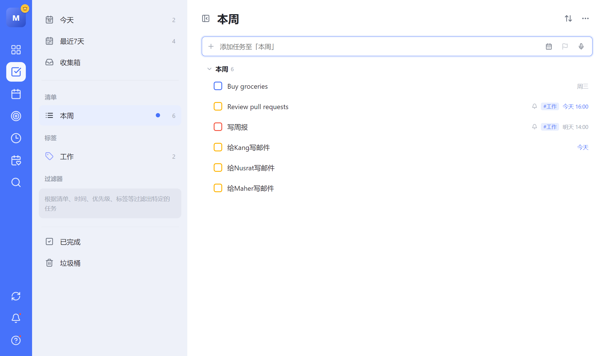
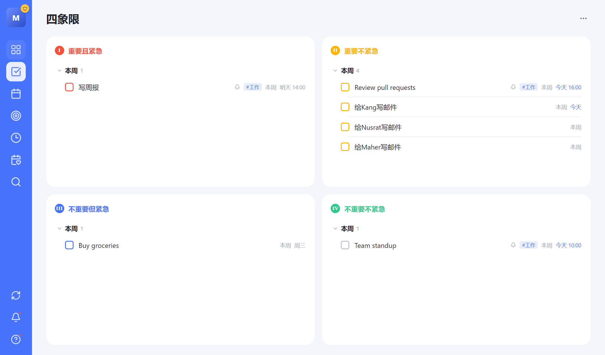
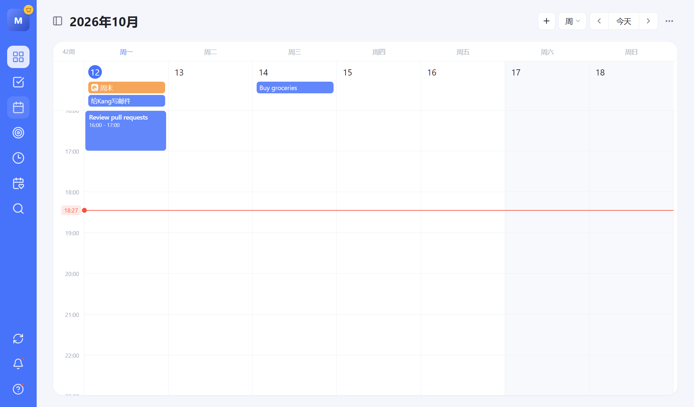
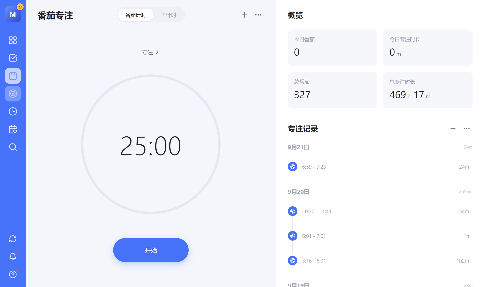
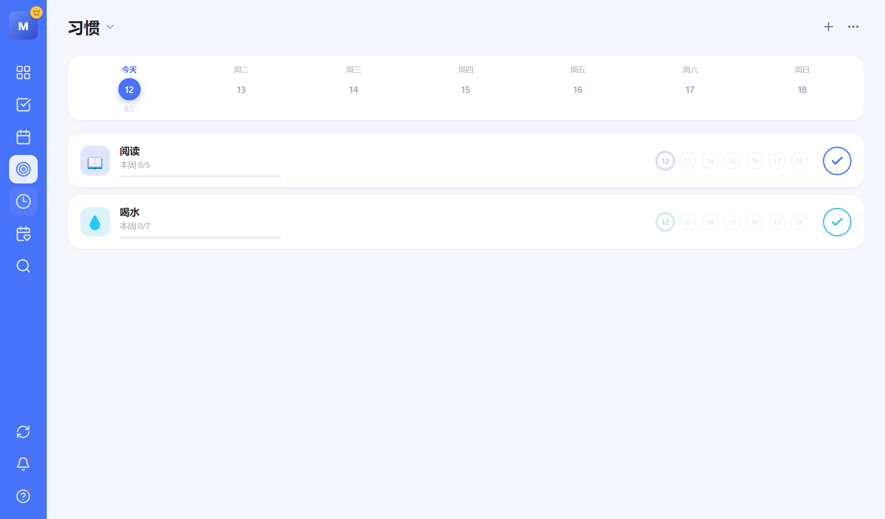
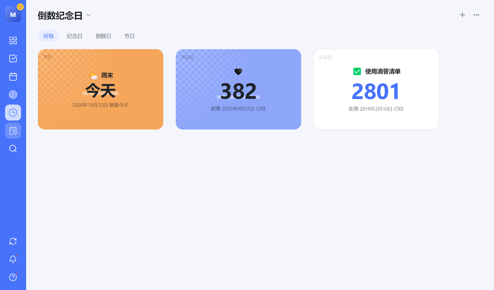
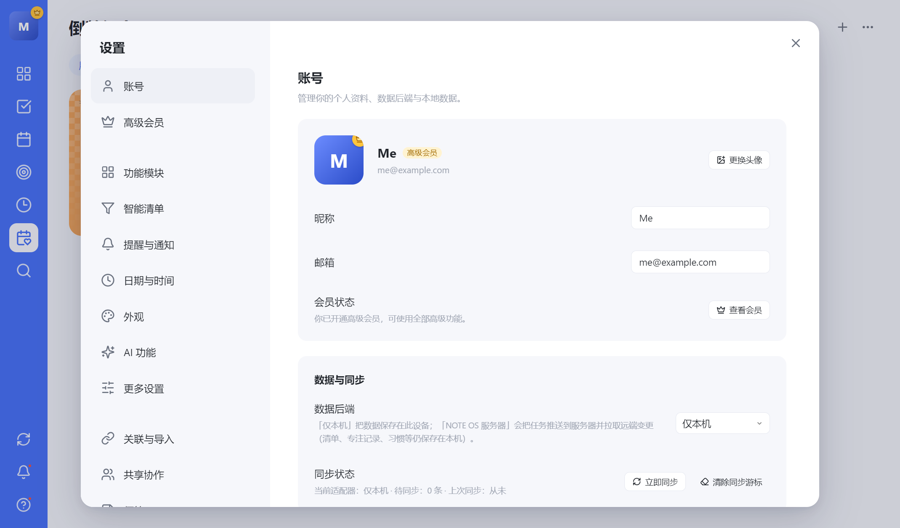

# ToDoList

A desktop to-do app in the style of TickTick (滴答清单): Eisenhower matrix, task lists, calendar, Pomodoro timer, habits, countdowns, AI task breakdown, and voice input. Built with React and Electron, offline-first, with a pluggable sync layer.

> Unofficial personal project. Not affiliated with or endorsed by TickTick / 滴答清单. The interface language is Simplified Chinese.

[中文说明](README.zh-CN.md)



## Screenshots

| Eisenhower matrix | Calendar |
| --- | --- |
|  |  |

| Pomodoro focus | Habits |
| --- | --- |
|  |  |

| Countdowns | Settings |
| --- | --- |
|  |  |

## Features

- **Eisenhower matrix.** Four quadrants driven by priority rules. Drag a task between quadrants to change its priority.
- **Tasks.** Smart lists (today, next 7 days, inbox, completed, trash), custom lists, tags, and saved filters. List, kanban, and timeline views with sorting, grouping, and drag-to-reorder.
- **Task details.** Due date and time, reminders, repeat rules, priority, subtasks, tags, and notes.
- **Smart quick add.** Type `明天 14:00 写周报 #工作 !高 ~本周` and the date, time, tag, priority, and list are parsed for you.
- **Calendar.** Day, week, and month views. Click to create, drag to reschedule, resize to change duration. Optional lunar dates and solar terms.
- **Pomodoro.** Countdown and stopwatch modes, automatic breaks, focus history, statistics, and built-in white noise.
- **Habits and countdowns.** Weekly goals, streaks, anniversaries, and day counters.
- **AI breakdown.** Split a task into 3 to 8 concrete steps, then add them as subtasks or as separate tasks.
- **Voice input.** Say several tasks in one sentence and review the parsed result before creating them.
- **Desktop extras.** Sticky-note windows, desktop widgets, system tray, global shortcuts, launch at login, and due-time notifications.
- **Appearance.** Light and dark themes, accent colors, compact mode, 12-hour or 24-hour clock.

## Getting started

Requires Node.js 20 or later.

```bash
git clone https://github.com/yunningtang/ToDoList.git
cd ToDoList
npm install
```

Run in the browser:

```bash
npm run dev
```

Run as a desktop app:

```bash
npm run desktop
```

On Windows you can also double-click `启动滴答清单.cmd`.

## AI and voice setup

AI features call a model with your own API key. Open **Settings → AI 功能** and enter:

- **Provider**: Anthropic, or any OpenAI-compatible endpoint.
- **API key and model**: stored only on your device.
- **Speech engine**: the browser's built-in recognition, or a Whisper-compatible endpoint. Electron does not ship built-in recognition, so the desktop app needs the Whisper option.

Without a key, voice input falls back to a local rule-based parser.

## Data and sync

All reads and writes go through a `DataAdapter` interface in [`src/data`](src/data).

| Adapter | Storage | Use |
| --- | --- | --- |
| `LocalAdapter` | `localStorage` on the device | Default. Works fully offline. |
| `HttpAdapter` | Local cache plus a remote server | Pushes changes to `POST /v1/sync/mutations` and pulls from `GET /v1/sync/changes`. |

Switch adapters under **Settings → 账号 → 数据与同步**. Changes made offline are queued and pushed on the next sync. A reference backend is not included yet.

You can export and import all data as JSON from the same settings page.

## Project structure

```
electron/            Main process and preload bridge
src/
  store/             Zustand store, types, seed data
  data/              DataAdapter interface, local and HTTP adapters
  services/          AI, speech, reminders, white noise, sticky notes
  components/
    views/           Matrix, tasks, calendar, Pomodoro, habits, countdowns
    modals/          Search and settings
    ai/              Breakdown and voice modals
    windows/         Sticky-note and widget windows
  utils/             Dates, lunar calendar, task helpers
  styles/            One stylesheet per view plus global tokens
```

## Tech stack

React 18, TypeScript, Vite, Zustand, Day.js, lucide-react, Electron.

## Roadmap

- Reference sync backend (FastAPI + SQLite)
- Installable PWA with a mobile layout
- English interface
- E-ink display companion
